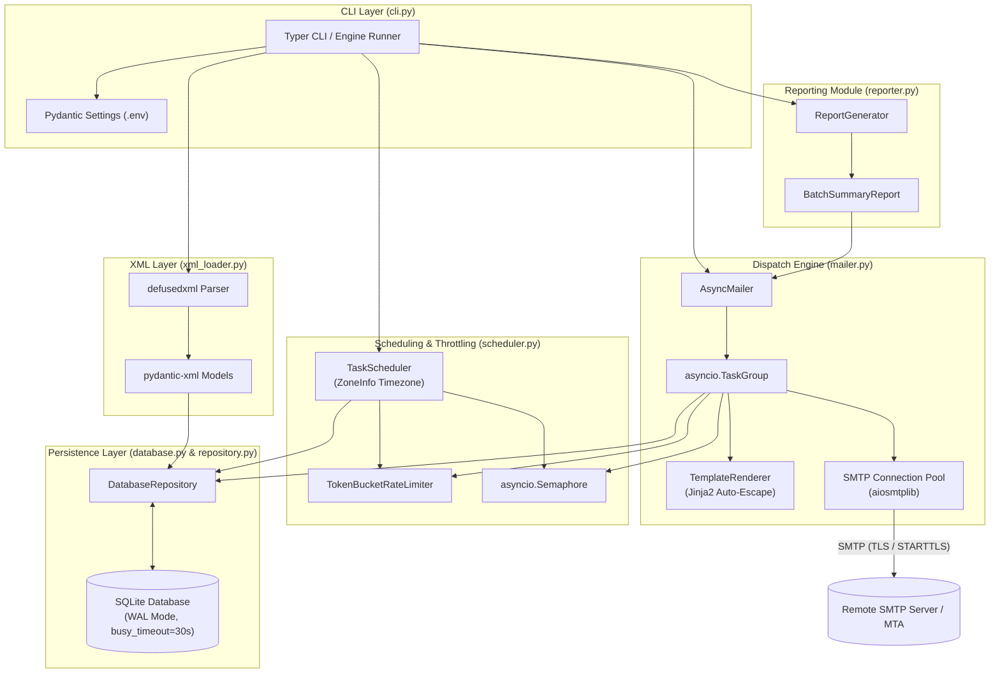
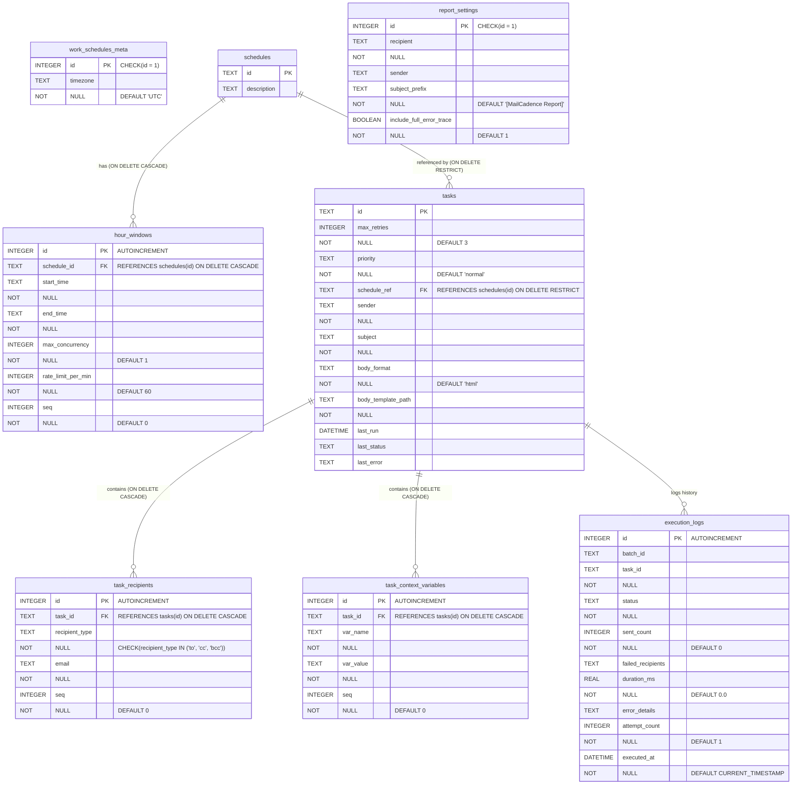
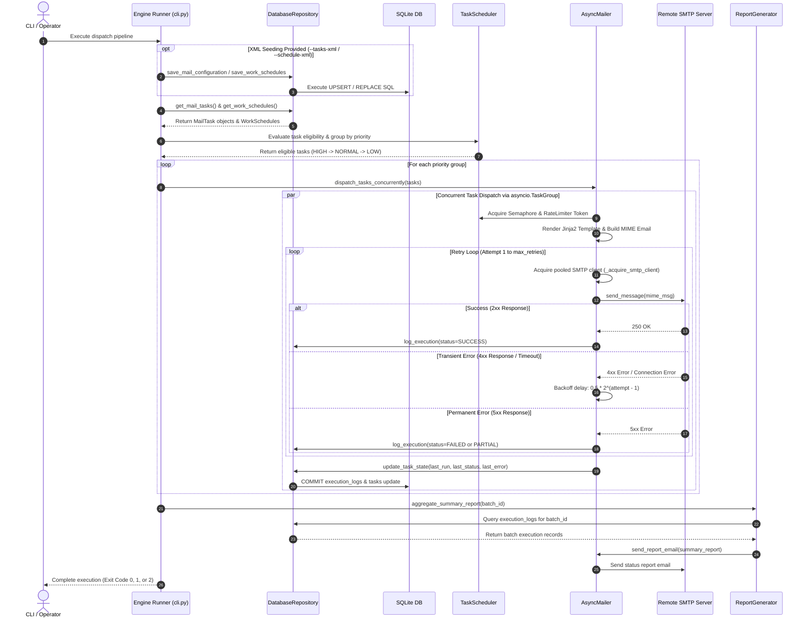
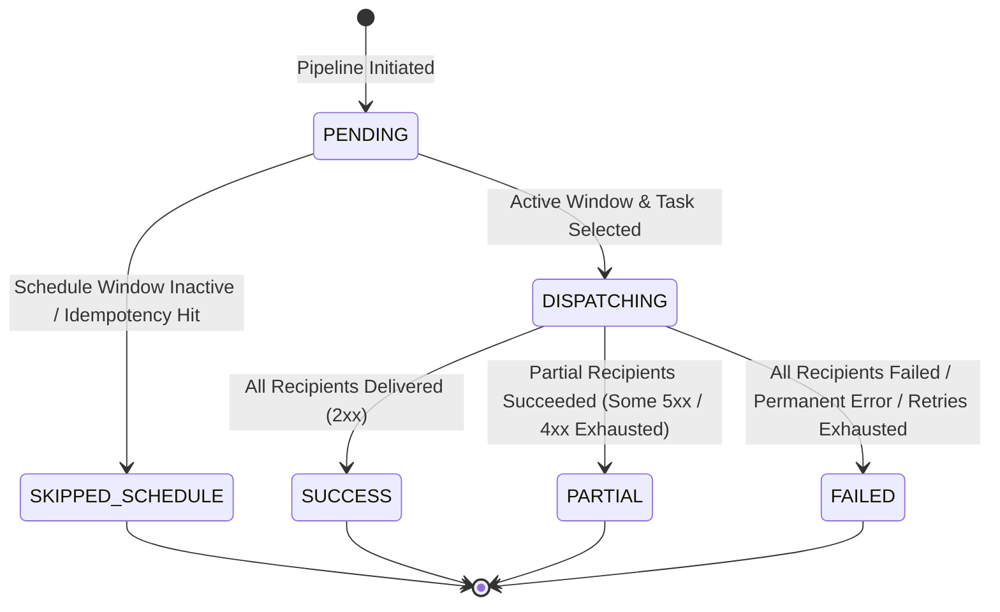

# MailCadence Architecture & Technical Documentation

Comprehensive, engineering-grade architectural specifications, database schema, data flows, and security controls for the `mail-cadence` execution engine.

---

## 1. System Overview & Component Architecture

### Core Modules & Responsibilities

`mail-cadence` is a high-throughput, asynchronous bulk email dispatch engine written in Python 3.12+. It utilizes SQLite for local state persistence and runtime execution tracking, while retaining XML support for schema-validated configuration import and export.

| Module | Location | Primary Responsibilities |
| --- | --- | --- |
| **CLI & Pipeline Engine** | `src/mail_cadence/cli.py` | Typer CLI entry points (`dispatch`, `import-xml`, `export-xml`), command-line argument parsing, environment settings resolution, and top-level pipeline orchestration via `run_dispatch_pipeline`. |
| **XML Loader & Exporter** | `src/mail_cadence/xml_loader.py` | Secure XML parsing via `defusedxml`, schema validation using `pydantic-xml` models (`MailConfiguration`, `WorkSchedules`), and bidirectional conversion between XML documents and SQLite data models. |
| **Database & Connection Manager** | `src/mail_cadence/database.py` | SQLite connection pooling initialization, database schema DDL execution, journal mode (`WAL`), busy timeout settings, and foreign key enforcements. |
| **Database Repository** | `src/mail_cadence/repository.py` | Data Access Object (DAO) providing transactional database operations (`upsert`, `replace`, state recovery, execution logging). Uses top-level transaction blocks (`with self.conn:`) to maintain single-statement and batch atomicity. |
| **Task Scheduler** | `src/mail_cadence/scheduler.py` | Timezone-aware schedule window evaluation (`zoneinfo`), active execution window calculation (including midnight-spanning window handling), window-level idempotency checking, and token bucket rate-limiting resource management. |
| **Async Mailer & Renderer** | `src/mail_cadence/mailer.py` | Async email dispatch engine using `aiosmtplib`, `asyncio.TaskGroup`, `asyncio.Semaphore`, and `TokenBucketRateLimiter`. Handles Jinja2 template rendering (`TemplateRenderer`), MIME message construction, connection pooling (`AsyncMailer._pool`), and exponential backoff retry logic. |
| **Status Reporter** | `src/mail_cadence/reporter.py` | Aggregates execution results into `BatchSummaryReport` and generates HTML/plain-text summary reports dispatched to operators upon task batch completion. |
| **Domain & Data Models** | `src/mail_cadence/models.py` | Pydantic v2 and `pydantic-xml` models, custom data types (`EmailPriority`, `TaskStatus`, `RecipientType`), string header validators, and Pydantic field transformations. |

---

### Component Architecture Diagram

The following C4 component diagram illustrates component boundaries and data flows across CLI, storage, scheduling, dispatching, and reporting layers:



---

## 2. Database Schema & Entity-Relationship Diagram (ERD)

### SQLite Pragma & Concurrency Configuration

`mail-cadence` configures SQLite for high concurrency, durability, and strict integrity via `database.py`:

- **Write-Ahead Logging (`PRAGMA journal_mode = WAL;`)**: Configured for file-backed databases to allow concurrent readers without blocking write transactions.
- **Busy Timeout (`PRAGMA busy_timeout = 30000;`)**: Wait up to 30,000 ms (30 seconds) on lock contention before raising `sqlite3.OperationalError`.
- **Foreign Key Enforcement (`PRAGMA foreign_keys = ON;`)**: Explicitly enabled per connection to guarantee referential integrity and execute cascade rules.
- **Transaction Atomicity Rules**: Public methods in `DatabaseRepository` execute SQL queries within top-level `with self.conn:` context managers. Private helper methods (`_save_task`, `_save_work_schedules`, etc.) omit `with self.conn:` context managers, allowing them to execute within the parent transaction without triggering premature commits.

---

### Entity-Relationship Diagram (ERD)



---

## 3. Domain & XML Data Models (`models.py` & `xml_loader.py`)

### Pydantic & `pydantic-xml` Model Mapping

Data structures map directly between XML elements, Pydantic objects, and SQLite relational tables:

| Pydantic / XML Model | XML Root / Tag | Target SQLite Table(s) | Parsing & Serialization Notes |
| --- | --- | --- | --- |
| `MailConfiguration` | `<MailConfiguration>` | Multi-table container | Root object containing `ReportSettings` and list of `MailTask` instances. |
| `ReportSettings` | `<ReportSettings>` | `report_settings` | Single-row singleton table (`id = 1`). |
| `MailTask` | `<MailTask>` | `tasks`, `task_recipients`, `task_context_variables` | XML attributes: `id`, `max_retries`, `priority`, `schedule_ref`. Elements: `Sender`, `Recipients` (`To`, `Cc`, `Bcc`), `Subject`, `BodyTemplate`, `ContextVariables` (`Var`). |
| `WorkSchedules` | `<WorkSchedules>` | `work_schedules_meta`, `schedules` | Root container with `timezone` attribute mapping to `work_schedules_meta.timezone` (`id = 1`). |
| `Schedule` | `<Schedule>` | `schedules` | XML attribute: `id`, `description`. Contains list of `HourWindow` objects. |
| `HourWindow` | `<HourWindow>` | `hour_windows` | Attributes: `start`, `end`, `max_concurrency`, `rate_limit_per_min`. FK to `schedules.id` (`ON DELETE CASCADE`). |

---

### Seeding Modes: `upsert` vs `replace`

When importing XML files using `DatabaseRepository.save_mail_configuration` and `DatabaseRepository.save_work_schedules`:

1. **`upsert` Mode (Default)**:
   - Updates existing records or inserts new records based on primary key matching (`tasks.id`, `schedules.id`).
   - For `schedules`: replaces child `hour_windows` for matched schedules.
   - For `tasks`: updates task metadata and replaces corresponding `task_recipients` and `task_context_variables`.
2. **`replace` Mode**:
   - Completely clears the target configuration tables prior to insertion (`DELETE FROM tasks`, `DELETE FROM schedules`, etc.).
   - Re-populates the database strictly from the provided XML files.

---

### Complete XML Examples

#### `tasks.xml`
```xml
<?xml version="1.0" encoding="UTF-8"?>
<MailConfiguration>
  <ReportSettings>
    <Recipient>ops-alerts@example.com</Recipient>
    <Sender>mailer-daemon@example.com</Sender>
    <SubjectPrefix>[MailCadence Status Report]</SubjectPrefix>
    <IncludeFullErrorTrace>true</IncludeFullErrorTrace>
  </ReportSettings>
  <Tasks>
    <MailTask id="TASK-001" max_retries="3" priority="high" schedule_ref="SCHED-MORNING">
      <Sender>noreply@example.com</Sender>
      <Recipients>
        <To>client.alpha@example.com</To>
        <To>client.beta@example.com</To>
        <Cc>account.manager@example.com</Cc>
        <Bcc>audit@example.com</Bcc>
      </Recipients>
      <Subject>Daily Operational Dispatch - EMEA</Subject>
      <BodyTemplate format="html">templates/daily_dispatch.html.j2</BodyTemplate>
      <ContextVariables>
        <Var name="region">EMEA</Var>
        <Var name="report_date">2026-10-17</Var>
      </ContextVariables>
    </MailTask>
  </Tasks>
</MailConfiguration>
```

#### `schedules.xml`
```xml
<?xml version="1.0" encoding="UTF-8"?>
<WorkSchedules timezone="Europe/Warsaw">
  <Schedule id="SCHED-MORNING" description="Morning operational window">
    <AllowedHours>
      <HourWindow start="06:00" end="12:00" max_concurrency="5" rate_limit_per_min="60"/>
    </AllowedHours>
  </Schedule>
  <Schedule id="SCHED-NIGHT" description="Overnight operational window">
    <AllowedHours>
      <HourWindow start="22:00" end="04:00" max_concurrency="2" rate_limit_per_min="30"/>
    </AllowedHours>
  </Schedule>
</WorkSchedules>
```

---

## 4. Scheduling, Idempotency & Rate Limiting (`scheduler.py`)

### Timezone-Aware Eligibility Evaluation

`TaskScheduler` converts system time to the defined IANA timezone (`zoneinfo.ZoneInfo`) configured in `work_schedules_meta.timezone`:

1. Retrieves current timestamp in target timezone `reference_dt = datetime.now(self.timezone)`.
2. Locates `Schedule` matching `task.schedule_ref`.
3. Checks if `reference_dt.time()` falls within any defined `HourWindow` for that schedule.

---

### Midnight-Spanning Execution Windows

For hour windows where `start_time > end_time` (e.g., `22:00` to `04:00`):

- If `reference_dt.time() >= start_time` (`23:00`):
  - `window_start_dt` = `ref_date 22:00`
  - `window_end_dt` = `(ref_date + 1 day) 04:00`
- If `reference_dt.time() < start_time` (`02:00`):
  - `window_start_dt` = `(ref_date - 1 day) 22:00`
  - `window_end_dt` = `ref_date 04:00`

---

### Window-Level Idempotency Protection

To prevent duplicate dispatches during an active schedule window:

- The engine evaluates `task.last_run` and `task.last_status`.
- If `task.last_status == TaskStatus.SUCCESS` and `window_start_dt <= task.last_run < window_end_dt`:
  - `is_task_eligible()` returns `False`.
  - The task is skipped with status `SKIPPED_SCHEDULE`.
- If `last_run` falls outside the active window instance or `last_status != SUCCESS` (e.g. `FAILED` or `PARTIAL`), the task is marked eligible for re-execution.

---

### Rate Limiting & Concurrency Architecture

`TokenBucketRateLimiter` enforces rate limits per minute using `time.monotonic()`:

- **Token Bucket Refill**: Tokens fill continuously at rate `rate_limit_per_min / 60.0` tokens/sec up to capacity `rate_limit_per_min`.
- **Resource Key Sharing**: `TaskScheduler` groups concurrency semaphores (`asyncio.Semaphore(window.max_concurrency)`) and rate limiters using a composite key: `(schedule_ref, window.start_time, window.end_time)`. All tasks sharing the same schedule window share the exact same semaphore and token bucket instance.

---

## 5. Dispatch Pipeline & SMTP Retry Flow (`cli.py`, `mailer.py`, `reporter.py`)

### Execution Sequence Diagram



---

### Task Status State Diagram



---

## 6. Security Architecture

`mail-cadence` implements defense-in-depth security measures across input processing, file handling, template rendering, and SMTP header construction:

### 1. XXE & Entity Expansion Protection (`defusedxml`)
- All XML inputs (`tasks.xml`, `schedules.xml`) are parsed via `defusedxml.ElementTree.fromstring` prior to passing DOM nodes into `pydantic-xml`.
- Prevents XML External Entity (XXE) attacks, billion laughs entity expansion, and DTD retrieval attacks.

### 2. Path Traversal Prevention (`TemplateRenderer`)
- Jinja2 template file paths specified in `<BodyTemplate>` are validated and resolved using `Path(template_path).resolve()`.
- Explicitly enforces that `resolved_path` must reside strictly within `base_dir` via `resolved_path.relative_to(base_dir)`. Attempting to reference files outside the template base directory raises a `ValueError`.

### 3. Cross-Site Scripting (XSS) Prevention
- Jinja2 environment configured with `autoescape=select_autoescape(["html", "xml"])`.
- Ensures context variables rendered into HTML email templates are auto-escaped.

### 4. SMTP Header Injection Prevention
- Header string fields (`sender`, `recipient`, `subject`, `to`, `cc`, `bcc`) are validated using `_check_no_newlines` Pydantic validators in `models.py`.
- Rejects inputs containing CR (`\r`) or LF (`\n`) characters, preventing SMTP command injection and unauthorized header injection.
